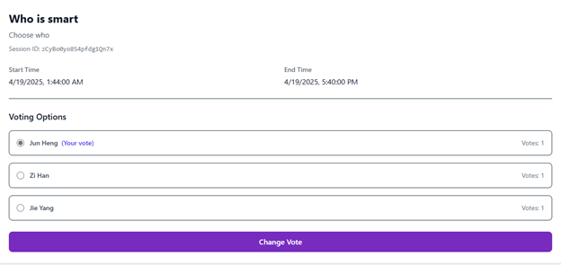

# VotingCloud 🗳️



A secure, scalable, and serverless-ready voting application built to demonstrate modern cloud application development practices. This project utilizes the Google Cloud Platform ecosystem to ensure high availability, real-time data consistency, and robust security.

## 🚀 Key Features

### Functional

- **User Management:** Secure Sign-up/Sign-in with **OTP verification** via EmailJS.
- **Real-Time Voting:** Instant vote updates and result visualization using Firestore listeners.
- **Session Management:** Users can create, edit, and search for voting sessions by ID.
- **Role-Based Access Control (RBAC):** Only session creators can modify options or delete votes; standard users are restricted to voting.

### Security

- **Authentication:** Firebase Authentication combined with custom **JWT validation** on the backend.
- **Data Protection:** Sensitive user IDs are encrypted using `bcrypt` (storage) and `AES/SHA256` (processing).
- **Network Security:** Enforced HTTPS/SSL via Firebase Hosting and Cloud Run.
- **Route Protection:** Frontend route guards to prevent unauthorized access.

### DevOps & Cloud Infrastructure

- **Auto-Scaling:** Backend deployed on **Google Cloud Run** with a generic scaling configuration (Min: 0, Max: 40 instances) to handle traffic spikes and reduce costs when idle.
- **Serverless Functions:** **Google Cloud Functions** handle background tasks like vote processing and submission logic.
- **Observability:** Integrated **Firebase Performance Monitoring** and **Google Cloud Logging** for structured error tracking and audit logs.
- **Alerting:** Automated alerts for high CPU usage (>80%) or error rate spikes.

## 🛠️ Tech Stack

| Component      | Technology        | Service/Platform                  |
| :------------- | :---------------- | :-------------------------------- |
| **Frontend**   | React.js          | Firebase Hosting                  |
| **Backend**    | Node.js / Express | Google Cloud Run (Dockerized)     |
| **Database**   | NoSQL             | Cloud Firestore                   |
| **Functions**  | JavaScript        | Cloud Functions                   |
| **Auth**       | JWT / OTP         | Firebase Auth & EmailJS           |
| **Monitoring** | SDK Integration   | Google Cloud Monitoring & Logging |

## 🏗️ Architecture & Deployment

The system follows a decoupled architecture:

1.  **Frontend:** Static assets served globally via Firebase Hosting.
2.  **Backend:** Containerized Node.js application deployed to Cloud Run (`asia-southeast1`).
3.  **Triggers:** Cloud Functions react to database changes to aggregate vote counts efficiently.

### Deployment Commands

**Frontend:**

```bash
firebase deploy --only hosting
```
